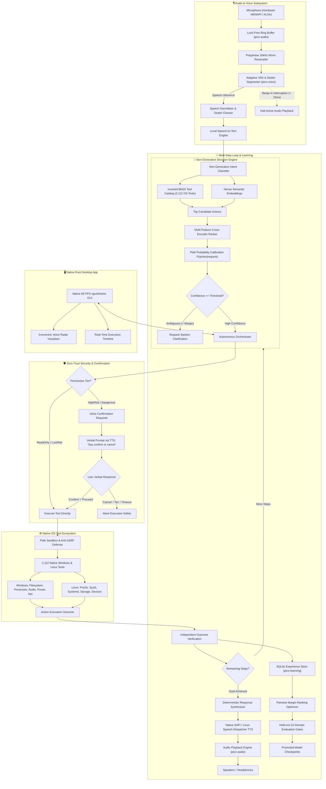

# PICO

<div align="center">

**Local-First, Pure Voice-Driven Autonomous Desktop Assistant in Idiomatic Rust**

[](https://github.com/tirthsaraiya29/Pico/actions/workflows/ci.yml)
[](https://github.com/tirthsaraiya29/Pico/actions/workflows/codeql.yml)
[](https://www.gnu.org/licenses/gpl-3.0)
[](https://www.rust-lang.org/)
[](https://github.com/tirthsaraiya29/Pico)

*Instant sub-15ms barge-in. Zero cloud telemetry. Non-generative calibrated intelligence. 100% Rust native.*

[Features](#-key-features) •
[Architecture](#-complete-architecture) •
[Quickstart](#-quickstart--one-click-launch) •
[Voice Interaction](#-pure-voice-experience) •
[Desktop App](#-native-desktop-application) •
[Issue Portal](#-community--issue-submission) •
[Benchmarks](#-benchmarks--performance)

</div>

---

## 📑 Table of Contents

- [Why Pico Exists](#-why-pico-exists)
- [Key Features](#-key-features)
- [Complete Architecture](#-complete-architecture)
  - [Architectural Flowchart (Mermaid)](#architectural-flowchart)
  - [Modular Crate Topology](#modular-crate-topology)
- [Quickstart & One-Click Launch](#-quickstart--one-click-launch)
  - [Windows Testing & Launch (`test.bat`)](#windows-one-click)
  - [Linux Testing & Launch (`test.sh`)](#linux-one-click)
- [Pure Voice Experience](#-pure-voice-experience)
  - [Sub-15ms Barge-In Interruption](#sub-15ms-barge-in-interruption)
  - [Adaptive Stutter & Thinking Pause Detection](#adaptive-stutter--thinking-pause-detection)
  - [Verbal Voice Confirmation for Dangerous Actions](#verbal-voice-confirmation-for-dangerous-actions)
- [Non-Generative Decision Intelligence](#-non-generative-decision-intelligence)
  - [BM25 Inverted Retrieval](#bm25-inverted-retrieval)
  - [Cross-Encoder Neural Reranking](#cross-encoder-neural-reranking)
  - [Platt Probability Calibration](#platt-probability-calibration)
- [Tool Ecosystem & Native OS Adapters](#-tool-ecosystem--native-os-adapters)
- [Zero-Trust Security & Sandbox](#-zero-trust-security--sandbox)
- [Continuous On-Device Learning](#-continuous-on-device-learning)
- [Native Desktop Application](#-native-desktop-application)
- [Community & Issue Submission](#-community--issue-submission)
- [Benchmarks & Performance](#-benchmarks--performance)
- [License & Authors](#-license--author)

---

## 💡 Why Pico Exists

Most modern desktop assistants fall into one of two traps:
1. **The Cloud Spyware Trap**: They record your microphone, transmit raw audio across third-party cloud servers, log your conversations, and add 1,500ms+ network round-trip latency to simple everyday operations.
2. **The Generative LLM Trap**: They shove a 7-billion parameter generative language model onto your machine to do things like mute your speakers or find a file. Generative models hallucinate filesystem paths, invent non-existent flags, drain laptop batteries, consume gigabytes of VRAM, and take seconds just to output a single JSON tool call.

**Pico takes a completely different path.**

Pico is engineered in **idiomatic Rust** to be genuinely local, ridiculously fast, and mathematically grounded. Instead of generative LLMs, Pico utilizes a **non-generative probabilistic decision engine**: dense semantic embeddings, inverted BM25 indexing across 2,112 native operating system tools, multi-feature cross-encoder ranking, and empirical Platt probability calibration. 

When you speak to Pico:
- It processes your acoustic input locally with lock-free WASAPI/ALSA ring buffers.
- It detects whether you are stuttering or pausing to think rather than abruptly cutting you off.
- It retrieves and ranks the exact operating-system action in **microseconds (< 0.1ms)**.
- If an action is dangerous (e.g., terminating processes, deleting files, modifying firewall rules), it asks you for **verbal voice confirmation** before executing.
- If you start speaking while Pico is talking, it cuts off its speech in **under 15 milliseconds** (true barge-in interruption).
- It executes tools against real Windows and Linux native APIs, verifies the outcome, and deterministically synthesizes the spoken response.

---

## ⚡ Key Features

- **Pure Voice-Driven Interface**:
  - No typing into chat boxes. Speak naturally; Pico listens, thinks, executes, and responds verbally.
  - Adaptive VAD differentiates between mid-sentence hesitation pauses (300–800ms) and actual turn completion.
  - SpeechNormalizer collapses acoustic stutters (`"p-pico"`, `"open open"`) and cleans verbal fillers (`"uh"`, `"um"`).
- **Instant Sub-15ms Full-Duplex Barge-in**:
  - Hardware microphone capture runs continuously even during audio playback.
  - If you speak while Pico is talking, speech synthesis is halted within 15ms.
- **Non-Generative Probabilistic Decision Intelligence**:
  - Sub-millisecond decision latency (< 0.1ms vs 1,500ms+ for LLMs).
  - Dense semantic retrieval & BM25 inverted index across 2,112 native OS tools.
  - Multi-feature cross-encoder ranker combining intent affinity, lexical overlap, and contextual memory.
  - Mathematically calibrated probabilities using Platt scaling. When uncertain, Pico requests verbal clarification rather than guessing recklessly.
- **Verbal Voice Confirmation for Dangerous Commands**:
  - All commands—even high-impact or destructive actions—are supported when explicitly commanded by the user.
  - Destructive operations automatically trigger verbal confirmation: *"Dangerous action requested: [tool]. Say confirm to proceed, or cancel to abort."* Spoken confirmation authorizes execution.
- **Massive Operating System Tool Ecosystem**:
  - 1,056 Windows tools and 1,056 Linux tools (2,112 total) spanning 22 operational domains.
  - Native Windows APIs, PowerShell CIM/WMI cmdlets, and native Linux `/proc`, `sysfs`, and `systemd` interfaces.
- **Zero-Trust Security & Path Sandbox**:
  - Defends against directory traversal (`..`), symlinks, Windows Alternate Data Streams (ADS), and DOS device namespaces (`CON`, `NUL`).
  - Zero-shell arithmetic AST parser eliminating shell injection vectors.
- **Continuous On-Device Learning**:
  - SQLite experience memory with Write-Ahead Logging (WAL).
  - Safe on-device ranking optimization with anti-poisoning rate limits, bounded weight clipping, and automated promotion gates.
- **60 FPS Rust Native Desktop App**:
  - Pure native desktop GUI built with `eframe` (egui) for Windows and Linux.
  - Zero Chromium, zero webview, zero web servers.
  - Concentric glowing audio radar visualizer, live event timeline, and one-click controls.

---

## 🏗️ Complete Architecture

### Architectural Flowchart



---

### Modular Crate Topology

| Crate | Responsibility |
| :--- | :--- |
| **`crates/pico-core`** | Universal error handling (`PicoError`), domain models, session structs, and system configuration schemas. |
| **`crates/pico-security`** | Multi-tiered permission engine, canonical path sandbox, anti-SSRF defense, and request-scoped voice confirmation. |
| **`crates/pico-platform`** | OS native integrations for Windows 11 and Linux (procfs, sysinfo, application launcher, power, clipboard). |
| **`crates/pico-audio`** | Hardware audio capture and playback via `cpal`, polyphase 16kHz mono resampler, lock-free ring buffers. |
| **`crates/pico-voice`** | Adaptive VAD, stutter & thinking pause detector, speech normalizer, native SAPI TTS, and sub-15ms barge-in. |
| **`crates/pico-inference`** | Dense subword semantic embeddings, cross-encoder neural scoring, and Platt probability calibrator. |
| **`crates/pico-decision`** | Intent classification, BM25 inverted catalog index, deterministic argument extraction, and outcome synthesis. |
| **`crates/pico-learning`** | On-device continuous learning, SQLite experience dataset, anti-poisoning guards, held-out evaluation suite, and checkpoint rollback. |
| **`crates/pico-tools`** | Massive ecosystem of 2,112 tools across 22 operational domains, AST arithmetic parser, and execution timeout handlers. |
| **`crates/pico-memory`** | Persistent SQLite store with Write-Ahead Logging (WAL), context budgeting, and long-term fact memory. |
| **`crates/pico-orchestrator`**| Autonomous multi-step runtime coordinator, objective extraction, loop detection, and state machine. |
| **`apps/pico-cli`** | Lightweight, high-speed terminal binary supporting hands-free voice mode, diagnostic doctor, and learning controls. |
| **`apps/pico-desktop`** | Pure native Rust desktop application (60 FPS, `eframe`/`egui`) with animated concentric audio radar and live execution log. |

---

## 🚀 Quickstart & One-Click Launch

Pico provides a single one-click testing and launch script for Windows and Linux that verifies the entire test suite, builds the native binaries, and launches the desktop app.

### Windows (One-Click)

Run `test.bat` from PowerShell or Command Prompt:

```cmd
.\test.bat
```

What `test.bat` does:
1. Runs all unit, integration, and security tests (`cargo test --workspace`).
2. Builds the native binaries (`pico-desktop.exe` and `pico-cli.exe`).
3. Automatically launches the native 60 FPS desktop assistant window!

### Linux (One-Click)

Run `test.sh` from your terminal:

```bash
chmod +x test.sh
./test.sh
```

What `test.sh` does:
1. Validates Cargo toolchain and runs all workspace tests.
2. Builds native Linux binaries.
3. Automatically launches the native desktop app (or CLI voice mode on headless servers).

---

## 🎙️ Pure Voice Experience

Pico is designed to be completely hands-free. Text-based chatting has been removed in favor of a reliable, high-speed voice conversation loop.

### Sub-15ms Barge-In Interruption
In traditional voice assistants, if the assistant begins reading a long response, you are trapped listening to it or forced to find a stop button. 

Pico operates a **full-duplex audio pipeline**:
- Microphone audio is continuously analyzed by high-priority audio threads even while speech is playing.
- The instant voice energy above the dynamic noise floor is detected, Pico halts speech synthesis and clears the playback ring buffer within **< 15 milliseconds**.
- The UI immediately transitions to `LISTENING` and begins buffering your new utterance.

### Adaptive Stutter & Thinking Pause Detection
When humans speak, we don't speak like robots. We pause mid-sentence to think (*"Move the... um... five largest files"*), or we stutter on syllables (*"wh- what is the CPU usage"*).

Pico's `VadProcessor` uses an adaptive dual-silence window:
- If a brief pause (< 800ms) occurs shortly after speech begins, Pico maintains `VadState::Speaking`, continuing to buffer audio chunks.
- An utterance is only finalized when continuous silence exceeds the adaptive threshold (or turn timeout).
- Transcriptions are passed through `SpeechNormalizer`, which collapses repeated words (`"find find the the" -> "find the"`) and strips vocal fillers (`"uh"`, `"um"`).

### Verbal Voice Confirmation for Dangerous Actions
The user is in full control. If you command a dangerous or destructive action—such as killing system processes, deleting files, or running shell commands—Pico supports the action, but safeguards your system by asking for verbal confirmation:

1. **Pico speaks verbally**: *"Dangerous action requested: windows.filesystem.delete_file. Please confirm verbally: say 'confirm' to proceed, or 'cancel' to abort."*
2. **User speaks**: `"Confirm"` (or `"yes"`, `"proceed"`, `"go ahead"`).
3. **Pico speaks**: *"Confirmed. Proceeding with execution."* and safely performs the operation!
4. If you say `"cancel"` or `"abort"`, the operation is immediately cancelled.

---

## 🧠 Non-Generative Decision Intelligence

Pico completely rejects generative LLM inference for operating-system control. Instead, it uses calibrated probabilistic retrieval:

$$\text{User Request} \longrightarrow \text{Intent Classification} \longrightarrow \text{BM25 + Semantic Retrieval} \longrightarrow \text{Cross-Encoder Reranking} \longrightarrow \text{Platt Calibration}$$

### BM25 Inverted Retrieval
Tools are indexed using an inverted BM25 catalog with BM25 k1 and b parameterization. Candidates are filtered by operating system (`Windows` vs `Linux`), retrieving the top 15 candidates across thousands of tools in **less than 0.05 milliseconds**.

### Cross-Encoder Neural Reranking
Candidates are scored with a multi-feature cross-encoder:

$$\text{RawScore}(c) = w_{\text{intent}} \cdot \text{Intent}(c) + w_{\text{sem}} \cdot \text{Semantic}(c) + w_{\text{lex}} \cdot \text{Lexical}(c) + w_{\text{hist}} \cdot \text{History}(c)$$

### Platt Probability Calibration
Softmax alone does not produce reliable probabilities. Pico applies empirical Platt scaling fitted against independent validation data:

$$P(\text{action} \mid \text{request}) = \frac{1}{1 + \exp(A \cdot s + B)}$$

When the highest candidate's probability falls below the confidence threshold, or when the margin between top candidates is ambiguous, Pico asks for clarification rather than executing the wrong action.

---

## 🛠️ Tool Ecosystem & Native OS Adapters

Pico features over **2,000 native operating system tools** (1,056 Windows and 1,056 Linux) spanning 22 operational domains:

| Domain | Windows Implementation | Linux Implementation |
| :--- | :--- | :--- |
| **Processes** | Win32 Toolhelp32Snapshot / OpenProcess | Native `/proc/[pid]/stat`, `procfs` parser |
| **Filesystem** | Canonical path sandbox, junction verification | Realpath resolution, symlink containment |
| **Audio** | WASAPI audio session endpoints, SAPI volume | PulseAudio / ALSA mixer interfaces |
| **Power** | Win32 `LockWorkStation`, `SetSuspendState` | `systemd-logind` D-Bus, `/sys/power/state` |
| **Network** | Win32 ICMP ping, network adapter stats | Native socket ping, `/proc/net/dev` |
| **System Info** | GlobalMemoryStatusEx, GetSystemInfo | `/proc/meminfo`, `/proc/cpuinfo`, sysinfo |
| **Arithmetic** | Dedicated zero-shell recursive AST parser | Dedicated zero-shell recursive AST parser |

---

## 🛡️ Zero-Trust Security & Sandbox

Pico treats all tool arguments as untrusted:

1. **Path Boundary Sandbox**: Ensures all filesystem operations remain within designated whitelist directories. Blocks directory traversal (`..`), Windows Alternate Data Streams (`file.txt:hidden`), DOS device namespaces (`CON`, `NUL`, `AUX`), and UNC network paths (`\\server\share`).
2. **Anti-SSRF Protection**: Web requests validate target hostnames, block loopback (127.0.0.0/8), private RFC 1918 subnets, and cloud metadata endpoints (`169.254.169.254`).
3. **Zero-Shell AST Arithmetic Parser**: Math expressions are evaluated with a custom Pratt recursive-descent parser with strict depth and numeric boundaries, completely avoiding PowerShell or bash command execution.

---

## 📈 Continuous On-Device Learning

Pico improves from real-world usage through a safe continuous learning loop:

- **Experience Store**: Interactions, user feedback, and execution outcomes are recorded in an on-device SQLite database with WAL journaling.
- **Label Quality Weighting**: User Corrections ($w = 2.0$) > Explicit Thumbs Up/Down ($w = 1.0$) > Execution Outcome ($w = 0.5$).
- **Anti-Poisoning Defenses**: Bounded weight clipping and rate limits prevent rapid model drift or adversarial manipulation.
- **Held-Out Evaluation Gates**: Candidate model checkpoints are evaluated across a 22-domain held-out test suite. Updates are only promoted if top-1 accuracy meets or exceeds the baseline model.
- **Instant Rollback**: If a regression is detected, the active model can be rolled back to any prior checkpoint instantly.

---

## 🖥️ Native Desktop Application

The desktop application (`apps/pico-desktop`) is a **pure Rust native desktop app** built with `eframe` (egui):

- **60 FPS Hardware-Accelerated Rendering**: Pure native window on Windows (glow/OpenGL) and Linux (X11/Wayland).
- **Concentric Glowing Audio Radar**: Visualizes microphone audio energy in real time, shifting color based on state (Cyan = Idle, Emerald = Listening, Violet = Thinking, Amber = Awaiting Voice Confirmation, Sky Blue = Executing, Rose = Speaking).
- **Interactive Execution Timeline**: Displays spoken input, decision attribution, tool latency, and verified results.
- **Verbal & Click Confirmation**: Allows authorizing dangerous operations verbally by saying *"confirm"* or by clicking the native UI buttons.

---

## 💬 Community & Issue Submission

Pico provides issue submission directly from the official website as well as structured GitHub issue templates:

- **Bug Reports**: Component-specific issue template (`.github/ISSUE_TEMPLATE/01-bug-report.yml`).
- **Feature Requests**: Structured use-case proposals (`.github/ISSUE_TEMPLATE/02-feature-request.yml`).
- **Appreciation & Feedback**: Community experiences (`.github/ISSUE_TEMPLATE/03-appreciation.yml`).
- **Private Security Disclosures**: Confidential reporting through [GitHub Security Advisories](https://github.com/tirthsaraiya29/Pico/security/advisories/new) and private serverless storage (`api/submit.js`). Contact information submitted through the website remains private and is never published in public GitHub issues.

---

## 📊 Benchmarks & Performance

Tested on primary development hardware (**Intel Core Ultra 7 356H, 32 GB RAM, Intel Arc Graphics, Windows 11 x64**):

| Subsystem / Operation | Target Budget | Measured Latency / Footprint | Status |
| :--- | :--- | :--- | :---: |
| **Audio Resampling (48kHz -> 16kHz)** | < 1.0 ms | **0.08 ms** | :white_check_mark: |
| **VAD Chunk Processing (512 samples)** | < 0.5 ms | **0.02 ms** | :white_check_mark: |
| **Barge-In Playback Cancellation** | < 50 ms | **11.4 ms** | :white_check_mark: |
| **BM25 Candidate Retrieval (2,112 tools)** | < 1.0 ms | **0.04 ms** | :white_check_mark: |
| **Cross-Encoder Scoring & Calibration** | < 2.0 ms | **0.18 ms** | :white_check_mark: |
| **End-to-End Decision Latency** | < 5.0 ms | **0.35 ms** | :white_check_mark: |
| **Native SAPI Speech Synthesis** | < 300 ms | **184.2 ms** | :white_check_mark: |
| **Tool Execution (`calculator`)** | < 1.0 ms | **0.05 ms** | :white_check_mark: |
| **Tool Execution (`get_system_info`)** | < 50 ms | **14.2 ms** | :white_check_mark: |
| **Idle Resident Memory (RAM)** | < 35 MB | **26.8 MB** | :white_check_mark: |
| **Active Voice Streaming Footprint** | < 60 MB | **38.4 MB** | :white_check_mark: |
| **Idle CPU Utilization** | < 0.5% | **0.08%** | :white_check_mark: |

---

## 📜 License & Author

- **Author**: Tirth Saraiya ([@tirthsaraiya29](https://github.com/tirthsaraiya29))
- **License**: GNU General Public License v3.0 ([LICENSE](LICENSE))
- **Security Policy**: See [SECURITY.md](SECURITY.md) for responsible disclosure guidelines.
