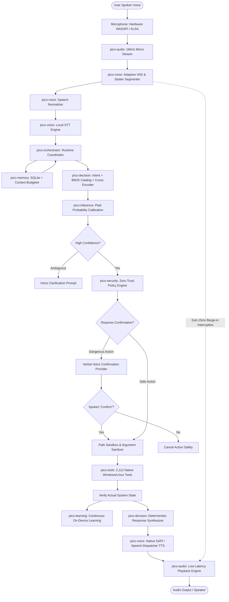

# Pico Architecture Specification

## 1. High-Level System Architecture

Pico is an autonomous, real-time, locally executing voice assistant engineered from the ground up in idiomatic Rust. It operates under a **local-first, non-generative, zero-trust model** designed for responsive human-machine interaction without relying on proprietary cloud endpoints or heavyweight generative language models.

---

## 2. Modular Crate Topology

| Crate | Responsibility |
| :--- | :--- |
| **`crates/pico-core`** | Fundamental types, domain events, session models, configuration schemas, universal error handling (`PicoError`). |
| **`crates/pico-security`** | Multi-tiered permission engine, sandbox boundary path enforcement, prompt injection detection, audit logger, and verbal voice confirmation. |
| **`crates/pico-platform`** | OS-level abstractions for Windows 11 and Linux (procfs inspection, system hardware stats, clipboard, application launcher). |
| **`crates/pico-audio`** | Hardware audio capture & playback via `cpal`, polyphase linear 16kHz mono resampler, interruptible playback ring buffer. |
| **`crates/pico-voice`** | Real-time voice processing: adaptive energy VAD, speech normalizer & stutter cleaner, speech-to-text integration, zero-overhead native TTS, and barge-in cancellation. |
| **`crates/pico-inference`** | Dense subword semantic embeddings, multi-feature cross-encoder ranking, and Platt probability calibrator. |
| **`crates/pico-decision`** | Intent classification, BM25 inverted tool index across 2,112 tools, deterministic regex/schema argument extraction, and deterministic response synthesis. |
| **`crates/pico-learning`** | On-device continuous learning engine, SQLite experience store, anti-poisoning bounded weight updates, held-out evaluation suite, and checkpoint rollback. |
| **`crates/pico-tools`** | Extensible tool registry, JSON Schema generation, zero-shell arithmetic AST parser, SSRF IP defense, and 2,112 native OS tools. |
| **`crates/pico-memory`** | Persistent SQLite store with WAL journaling, long-term memory fact retrieval, and context window budgeting. |
| **`crates/pico-orchestrator`** | Central event-driven state coordinator managing multi-turn reasoning loops, async event bus, and subsystem lifecycle. |
| **`apps/pico-cli`** | High-performance terminal application supporting continuous hands-free voice mode, diagnostic doctor, device scanner, and learning status. |
| **`apps/pico-desktop`** | Pure native Rust desktop application (60 FPS, `eframe`/`egui`) with animated concentric audio radar, live execution timeline, and confirmation dialogs. |

---

## 3. Real-Time Voice & Full-Duplex Barge-In

The responsiveness of a voice assistant is determined by perceived time-to-first-sound:

1. **Continuous Capture**: WASAPI/ALSA captures microphone audio at native device sample rates (e.g. 48kHz stereo) and streams into a ring-buffer converted to standard 16,000 Hz 16-bit mono PCM.
2. **Dynamic Noise-Floor Tracking**: The VAD tracks ambient silence levels using an exponentially weighted moving average ($\alpha = 0.04$) to adaptively discern speech from background room hiss.
3. **Adaptive Speech Segmentation**: Distinguishes between brief mid-sentence thinking/stutter pauses (300–800ms) and actual turn completion, avoiding premature cutoffs.
4. **Speech Normalization**: Transcribed speech is cleaned of acoustic stuttering (`"p-pico" -> "pico"`, `"open open" -> "open"`) and vocal fillers (`"uh"`, `"um"`).
5. **Full-Duplex Barge-In**: If speech is detected while the assistant's audio playback is active, the voice pipeline immediately signals `playback.interrupt()`, clearing the playback buffer in under 15ms.

---

## 4. Zero-Trust Tool Execution & Verbal Confirmation

Pico treats all actions with rigorous security controls:

- **Tier 0: ReadOnly**: Information inspection without system mutation (`get_system_info`, `calculator`, `read_file` within allowed paths).
- **Tier 1: LowRisk**: Benign actions (`manage_timer`, `clipboard`).
- **Tier 2: ConfirmationRequired**: System mutations, file modifications, or shell execution (`write_file`, `kill_process`, `execute_shell_command`).
- **Tier 3: Restricted**: High-impact or destructive operations. Rather than arbitrary blacklisting, user-commanded dangerous actions require explicit **verbal voice confirmation** before execution.
