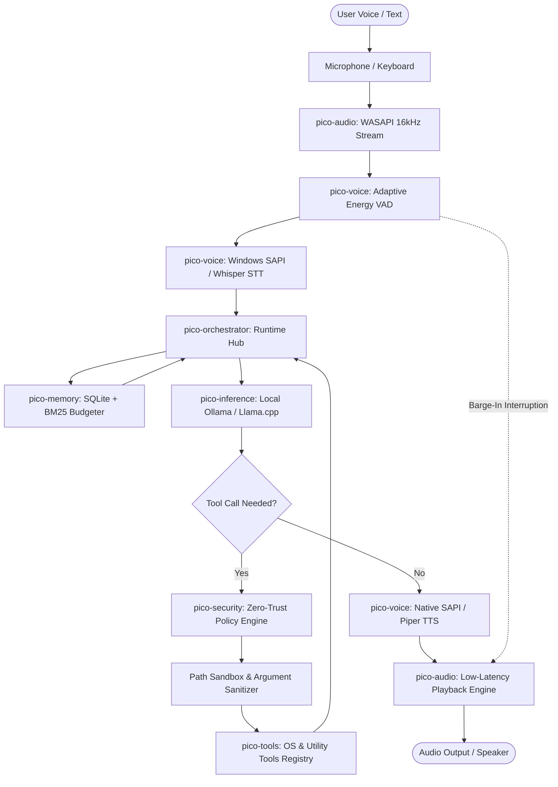

# Pico Architecture Specification

## 1. High-Level System Architecture

Pico is an autonomous, real-time, locally capable AI voice assistant engineered from the ground up in idiomatic Rust. It operates under a **local-first, zero-trust model** designed for responsive human-machine interaction without relying on proprietary cloud endpoints.

---

## 2. Workspace Modular Topology

| Crate | Responsibility |
| :--- | :--- |
| **`crates/pico-core`** | Fundamental types, domain events, session models, configuration schemas, universal error handling (`PicoError`). |
| **`crates/pico-security`** | Multi-tiered permission engine, sandbox boundary path enforcement, prompt injection detection, audit logger. |
| **`crates/pico-platform`** | OS-level abstractions for Windows 11 (process enumeration/termination, power status, system hardware stats, clipboard). |
| **`crates/pico-audio`** | Hardware audio capture & playback via `cpal`, polyphase linear 16kHz mono resampler, interruptible playback ring buffer. |
| **`crates/pico-voice`** | Real-time voice processing: adaptive energy VAD, speech-to-text integration, zero-overhead Windows SAPI TTS, barge-in cancellation. |
| **`crates/pico-inference`** | Model backends: Ollama native/v1 HTTP, llama-server Vulkan runner, OpenAI-compatible streaming SSE, structured decision parsing. |
| **`crates/pico-tools`** | Extensible tool registry, JSON Schema generation, tool execution with timeouts and cancellation. |
| **`crates/pico-memory`** | Persistent SQLite store with WAL journaling, FTS5 relevance retrieval, context window budgeting. |
| **`crates/pico-orchestrator`** | Central event-driven state coordinator managing multi-turn reasoning loops, async event bus, and subsystem lifecycle. |
| **`apps/pico-cli`** | High-performance terminal application supporting interactive chat, continuous hands-free voice mode, and system diagnostics (`doctor`). |
| **`apps/pico-desktop`** | Lightweight desktop application and WebGL 3D landing interface featuring Three.js neural visualizer, real-time audio oscilloscope, and WebSocket telemetry. |

---

## 3. Real-Time Voice & Barge-In Mechanics

The latency of a voice assistant is determined by perceived time-to-first-sound:

1. **Continuous Capture**: WASAPI captures microphone audio at native device sample rates (e.g. 48kHz stereo) and streams into a ring-buffer converted to standard 16,000 Hz 16-bit mono PCM.
2. **Dynamic Noise-Floor Tracking**: The VAD tracks ambient silence levels using an exponentially weighted moving average ($\alpha = 0.05$) to adaptively discern speech from background hiss.
3. **Speech Utterance Finalization**: When speech concludes and 700ms of sustained sub-threshold audio is observed, the buffered speech chunk is dispatched to speech recognition.
4. **Barge-In Detection**: If speech is detected while the assistant's audio playback is active, the voice pipeline immediately signals `playback.interrupt()`, clearing the playback buffer in under 15ms and halting ongoing model generation.

---

## 4. Zero-Trust Tool Execution Model

LLM output is treated as untrusted input. The execution pipeline enforces 4 strict permission tiers:

- **Tier 0: ReadOnly**: Information inspection without system mutation (`get_system_info`, `calculator`, `read_file` within allowed paths).
- **Tier 1: LowRisk**: Benign actions (`manage_timer`, `clipboard`).
- **Tier 2: ConfirmationRequired**: Mutations, file modifications, or shell execution (`write_file`, `kill_process`, `execute_shell_command`).
- **Tier 3: Restricted**: Blacklisted operations that cannot run under any circumstances.
