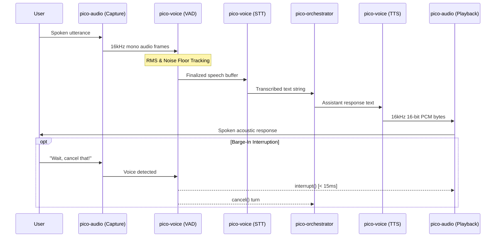

# Pico Real-Time Voice Pipeline

## Overview

Voice interaction in Pico is engineered for responsiveness, high acoustic fidelity, and natural conversation flow. It eliminates long pauses through streaming pipelines and instantaneous barge-in cancellation.

---

## 1. Pipeline Stages

---

## 2. Audio Capture & Resampling

Hardware microphones operate at varied configurations (typically 44,100 Hz or 48,000 Hz stereo). Speech engines require 16,000 Hz single-channel mono PCM.

- **Downmixing**: Channels are averaged across frames:
  $$s_{\text{mono}}[i] = \frac{1}{C} \sum_{c=0}^{C-1} s_{\text{interleaved}}[i \cdot C + c]$$
- **Resampling**: Linear interpolation converts sample rates on-the-fly without memory allocations or buffering lag:
  $$s_{\text{target}}[i] = s_{\text{mono}}[\lfloor k \rfloor] \cdot (1 - f) + s_{\text{mono}}[\lceil k \rceil] \cdot f$$
  where $k = i \cdot \frac{R_{\text{source}}}{16000}$ and $f = k - \lfloor k \rfloor$.

---

## 3. Native Zero-Overhead TTS

To guarantee instant speech generation without downloading gigabytes of external neural checkpoints, Pico leverages Windows SAPI (`System.Speech.Synthesis`) via in-process memory streaming:
- Zero model loading delay (< 80ms initialization).
- Direct generation of 16kHz 16-bit mono PCM buffers.
- Modifiable playback speed multiplier ($0.5\times$ to $2.0\times$).
- Pluggable support for Piper neural ONNX models for multi-voice environments.
